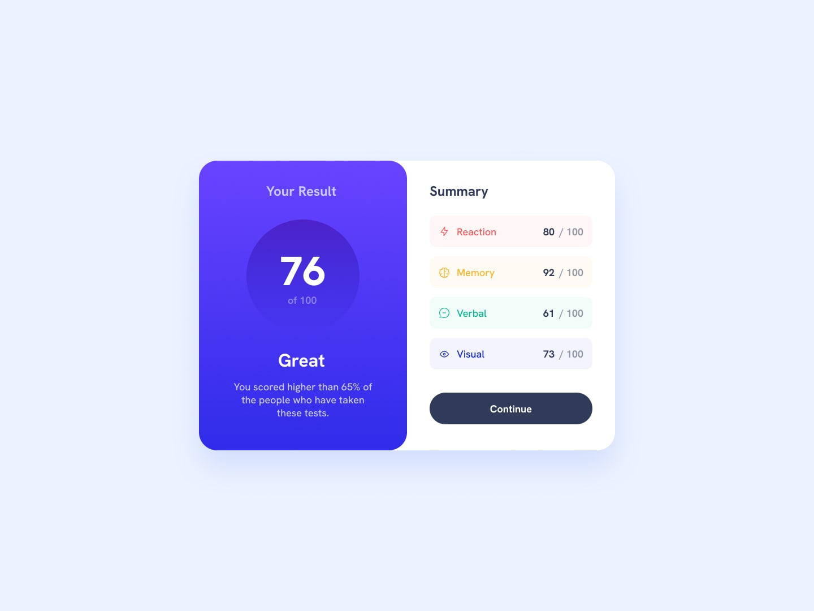

# Results Summary Component

A responsive results summary card built to match the Frontend Mentor design challenge. This project focuses on creating a clean, mobile-first layout with a desktop view that mirrors the provided mockup as closely as possible.

## Overview

This challenge was all about translating a static design into a working front-end layout using HTML and CSS. The goal was to recreate the results summary component with:

- a gradient result panel on the left
- a summary section on the right
- category rows with colored backgrounds and icons
- a final call-to-action button
- responsive behavior between mobile and desktop layouts

## What I built

The page includes:

- a score circle showing the overall result
- a short performance message under the total score
- a category breakdown for Reaction, Memory, Verbal, and Visual
- a CTA button styled to match the mockup
- a clean and centered card layout for desktop screens

## Challenges I faced

One of the biggest problems I ran into was during the desktop layout. I kept trying to get the main container to behave correctly, but the issue turned out to be caused by `align-items: center` on the flex parent.

At first, it seemed like the container itself wasn’t filling properly or the sections weren’t sitting the way they should. But after testing different approaches and checking the structure carefully, I realized the problem wasn’t the card itself — it was the flex behavior. The parent container was trying to center items along the cross axis, which prevented the inner sections from stretching and aligning the same way as the design.

That was a key learning moment for me because it reminded me that small CSS properties can completely change layout behavior. Once I adjusted the flex structure and removed the property that was interfering with the layout, the desktop design finally matched the intended composition much more closely.

## Lessons learned

This project taught me a lot about:

- how flexbox affects alignment and sizing
- the importance of checking parent-child layout behavior
- how small styling issues can change the entire design
- designing mobile-first and then scaling up to desktop
- using spacing and color consistently to match a reference design more closely

## Tech stack

- HTML5
- CSS3
- Google Fonts
- Local SVG assets from the project

## Final thoughts

This was a great project for learning how CSS layout decisions affect the final result. The biggest win wasn’t just finishing the design — it was understanding why a layout bug happened and learning how to fix it by reasoning through the flexbox structure instead of guessing.

I’m glad I finally caught the issue and improved the layout because it made the project feel much more complete and helped me become more confident with CSS.

Thank you Frontendmentor.
